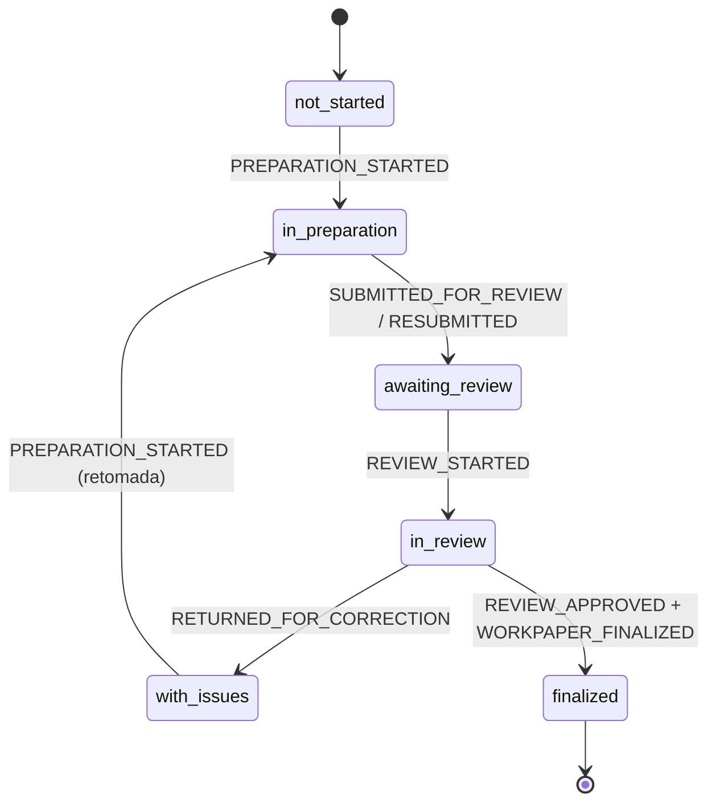

# SGA — Workflow formal de PTAs e histórico de eventos v0.1

Incremento 02A. Este documento explica como o fluxo formal de revisão funciona, como o histórico de eventos é gravado e o que fica preparado para o Incremento 02B.

Escopo: frontend Angular com persistência demonstrativa no navegador. Não há backend, API ou conexão com o Trello.

Ver também: [SGA-INTEGRACAO-ENTIDADES-v0.1.md](./SGA-INTEGRACAO-ENTIDADES-v0.1.md) (Incremento 01).

---

## 1. Estados do PTA

Os valores internos existentes foram preservados (`WorkpaperStatus`).

| Valor | Rótulo | Significado |
|---|---|---|
| `not_started` | Não iniciado | Preparação ainda não começou |
| `in_preparation` | Em preparação | Preparação ou correção em andamento |
| `awaiting_review` | Aguardando revisão | Enviado; ciclo de revisão aberto |
| `in_review` | Em revisão | Revisão formal iniciada pelo revisor |
| `with_issues` | Com pendência | Devolvido ao preparador |
| `finalized` | Finalizado | Revisão aprovada e PTA concluído |

## 2. Transições permitidas



As transições estão em `WORKPAPER_TRANSITIONS` (`core/data/workpaper-workflow.ts`). Qualquer outra transição é recusada, por exemplo:

- Não iniciado → Finalizado;
- Em preparação → Finalizado;
- Aguardando revisão → Finalizado;
- Com pendência → Aguardando revisão (o reenvio direto, que a regra antiga `canSubmitForReview` permitia, foi removido);
- Finalizado → qualquer status.

A reabertura (`WORKPAPER_REOPENED`) existe só no contrato. Ela exigirá uma operação própria e autorizada em um incremento futuro.

## 3. Eventos formais

| Evento | Comando | Efeito |
|---|---|---|
| `PREPARATION_STARTED` | Iniciar / Retomar preparação | → `in_preparation` (`payload.fromStatus` distingue início de retomada) |
| `SUBMITTED_FOR_REVIEW` | Enviar para revisão | → `awaiting_review`, abre o ciclo 1 |
| `RESUBMITTED` | Reenviar para revisão | → `awaiting_review`, abre o ciclo N+1 (`previousCycleId`) |
| `REVIEW_STARTED` | Iniciar revisão | → `in_review`, registra revisor e início no ciclo |
| `REVIEW_NOTE_CREATED` | Adicionar ponto de revisão | Cria ponto aberto no ciclo ativo (não devolve o PTA) |
| `REVIEW_NOTE_RESOLVED` | Marcar como resolvido | Fecha o ponto (não aprova nem reenvia) |
| `RETURNED_FOR_CORRECTION` | Devolver para correção | → `with_issues`, encerra o ciclo como `returned` |
| `REVIEW_APPROVED` | Aprovar e finalizar | Encerra o ciclo como `approved` |
| `WORKPAPER_FINALIZED` | (mesma operação) | → `finalized`; `causationId` aponta para a aprovação |

`WORKPAPER_CREATED` existe no contrato, mas não é emitido: o protótipo não tem criação de PTA. Nenhum evento retroativo é fabricado para os PTAs do mock.

## 4. Eventos operacionais

`BOARD_CARD_MOVED` (e, no contrato, `BOARD_CARD_CREATED` e `BOARD_CARD_ASSIGNED`) registra a organização do trabalho no Kanban.

- **Não altera o estado formal.** Arrastar um cartão para "Concluído" não aprova o PTA, e "Em revisão" não significa que o revisor iniciou a análise.
- **Não é aplicado ao status.** A reconstituição só aplica eventos formais com `entityType: 'workpaper'`.
- **Trello sem autoridade formal.** `validateAuditEvent` rejeita evento formal com `source: 'trello'`.

## 5. Estrutura do AuditEvent

Envelope (`core/models/audit-event.model.ts`), `schemaVersion: 1`:

| Campo | Descrição |
|---|---|
| `id` | `EV-000001`; único no log |
| `sequence` | Ordem de registro (monotônica); desempata eventos simultâneos |
| `eventType` / `eventCategory` | Tipo e natureza (`formal` / `operational`) |
| `entityType` / `entityId` | `workpaper` ou `board_card` |
| `engagementId` | Obrigatório; `workpaperId` e `reviewCycleId` quando aplicáveis |
| `actorId` | Usuário da sessão no momento do ato |
| `occurredAt` / `recordedAt` | ISO 8601 em UTC. No SGA coincidem; importações futuras terão `recordedAt` posterior |
| `source` | `sga` · `trello` · `import`; `externalEventId` para idempotência |
| `correlationId` / `causationId` | Agrupam e encadeiam os eventos de uma operação |
| `payload` | **Discriminado por `eventType`** (`WorkpaperEventPayloads`, `BoardCardEventPayloads`) |

Datas são gravadas em ISO e formatadas só na exibição (pipe `dateTime`: "05/09/2026 — 13h34", horário de Brasília).

O relógio do workflow é monotônico: um novo evento nunca é anterior ao último registrado. Isso é necessário porque o relógio do protótipo reinicia em 06/10/2026 a cada recarga.

## 6. ReviewCycle

Ver `core/models/review-cycle.model.ts`.

- **Abertura.** O envio cria o ciclo 1 (`RC-<PTA>-1`). Cada reenvio cria um ciclo novo (`RC-<PTA>-2`, …). Ids nunca são reaproveitados.
- **Encerramento.** O ciclo termina como `returned` (com `returnReason`) ou `approved`. Ciclos anteriores nunca são sobrescritos.
- **Ciclo `legacy`.** Um PTA que já estava em revisão no mock abre, na primeira ação, um ciclo com `origin: 'legacy'` e sem data de envio, porque o envio é anterior ao histórico.

## 7. ReviewNote

Ver `core/models/review-note.model.ts`.

- **Criação.** O revisor registra pontos durante `in_review`, no ciclo ativo, com descrição e severidade (baixa, média, alta, crítica). O responsável pela correção é o preparador.
- **Resolução.** O preparador resolve pontos em `with_issues` ou `in_preparation`. O ponto continua no histórico com autor, data e resolução.
- **Bloqueio.** No protótipo, **todo ponto aberto bloqueia** a aprovação e o reenvio.
- **Pontos herdados.** `RN-01`/`RN-02` do PTA-REC-001 (tipo `LegacyReviewNote`) são exibidos à parte e não participam das regras.

## 8. Política de autoridade

- **Porta única.** `WorkpaperWorkflowService.execute()` é a única entrada para atos formais. Componentes e Kanban não alteram status. `WorkpaperRepository.updateStatus` e `WorkpaperService.submitForReview` foram removidos.
- **Ator.** O autor vem sempre da `SessionService`, nunca de parâmetro da tela. Sem usuário identificado, o erro é `no_actor`.
- **Papéis**, a partir da atribuição já existente no PTA:
  - preparação (iniciar, enviar, reenviar, resolver): preparador designado;
  - revisão (iniciar revisão, pontos, devolver, aprovar): revisor designado, que não pode ser o preparador.
- **Exibição na tela.** Ações inválidas para o status não aparecem. Ações válidas, mas de outro papel, aparecem desabilitadas com o motivo e o nome do responsável.
- **Limite de segurança.** São controles de frontend em ambiente demonstrativo e **não constituem segurança de produção**. A autorização definitiva será do backend.

## 9. Persistência demonstrativa

- **Documento.** Fica em `localStorage['sga.workflow.v1']` e é separado da sessão (`sga.persona`) e dos quadros (`sga.board.*`):

  ```json
  { "schemaVersion": 1, "revision": 11, "baselines": { "PTA-REC-001": { "status": "in_preparation", "capturedAt": "…" } }, "events": [ … ] }
  ```

- **`baselines`** guarda o status herdado do mock na primeira operação de cada PTA.
- **Estado derivado.** Status, ciclos e pontos são projeções puras do log (`reconstituteWorkpaper`) e não são gravados.
- **Leitura.** `parseWorkflowLog` valida versão e estrutura. Dados inválidos **não são apagados** (erro `corrupted_storage`). A tela do PTA oferece "Restaurar demonstração…", com confirmação, e grava antes uma cópia em `sga.workflow.v1.backup`.
- **Restauração.** Afeta só o histórico. Quadros, sessão e preferências permanecem.

## 10. Regras de consistência

- **Gravação única.** Cada operação grava **todos os seus eventos numa única escrita** do documento (`WorkflowRepository.append`). A aprovação grava os 2 eventos juntos.
- **Validação antes de gravar.** Se a validação falha, nada é gravado. Se a escrita falha, o erro é `storage_failure`, o histórico fica intacto e a tela não confirma a operação.
- **Concorrência.** A gravação exige a revisão lida antes (`expectedRevision`). Outra aba que gravou antes causa `conflict`.
- **Append-only.** Eventos nunca são editados nem removidos (exceto pela restauração explícita da demonstração). Ids e sequências repetidos são rejeitados.
- **Ordem determinística.** A ordem é `occurredAt`, depois `sequence`, depois `id`.
- **Anomalias.** Um evento que viola a máquina de estados (por exemplo, importado fora de ordem) **não é aplicado**: vira anomalia visível no histórico e bloqueia novas ações formais no PTA até ser regularizado.
- **Leitura entre telas.** `WorkpaperRepository` devolve o status formal projetado, então lista de PTAs, Trabalhos, Dashboard e Qualidade leem o mesmo status do histórico.

## 11. Integração Kanban

- **Direção.** Somente PTA → Kanban (`BoardService.list()` → `applyWorkflowProjection`).
- **Cartões afetados.** Só os do tipo `workpaper` com `workpaperId`. Tarefas, revisões e pendências ligadas ao PTA não são movidas.
- **Mapeamento pelo id da coluna:**

  | Status | Coluna |
  |---|---|
  | `not_started` | Backlog/Planejado (mantém a posição se já estiver em uma delas) |
  | `in_preparation` | `in_progress` |
  | `awaiting_review`, `in_review` | `in_review` |
  | `with_issues` | `issues` |
  | `finalized` | `done` |

- **Uma vez por evento formal.** O cartão guarda `projectedEventId`. Depois disso, arrastar é operacional e não é desfeito, até o próximo evento formal.
- **Sem loops.** A projeção nunca chama o workflow nem grava eventos. Arrastar um cartão grava apenas `BOARD_CARD_MOVED`.
- **Status formal à vista.** O cartão e o painel mostram "PTA: <status formal>", com destaque quando a coluna difere do status formal.
- **Histórico ilegível.** O Kanban continua funcionando; só a projeção é suspensa.

## 12. Preparação para Trello

`ExternalReference` e a resolução externa do Incremento 01 não mudaram. O fluxo futuro é:

```text
Trello API → adaptador → ExternalReference → BOARD_CARD_* (operacional) → projeção do SGA
```

Um evento do Trello nunca chama `execute()`. Atos formais só nascem no SGA, e `validateAuditEvent` recusa evento formal com origem `trello`. Não há cliente HTTP, OAuth, webhooks, polling nem tokens.

## 13. Preparação para Qualidade (Incremento 02B)

`workflowFacts(log, dimensionsOf)` (`core/data/workflow-projection.ts`) devolve dois conjuntos de fatos:

- **`ReviewCycleFact`**: PTA, trabalho, cliente, área, preparador, revisor, ciclo, sequência, origem, envio, início da revisão, conclusão, resultado e número de pontos.
- **`ReviewNoteFact`**: ponto, ciclo, severidade, status, criação e resolução.

Como o 02B pode consumir:

1. Carregar o log (`WorkflowRepository.load()`) e o catálogo de entidades (`EntityResolutionService`).
2. Montar `dimensionsOf` a partir do catálogo, por id e nunca por nome.
3. Projetar observações:
   - tempo de ciclo = `completedAt − submittedAt` (só ciclos `recorded`);
   - retrabalho = ciclos `returned` ÷ ciclos concluídos no período;
   - review notes por 100 PTAs = pontos ÷ ciclos revisados;
   - resolução = `resolvedAt − createdAt`.
4. Manter essas observações **separadas** do mock estatístico demonstrativo e das baselines congeladas.

Nesta etapa nada disso alimenta as cartas. As seis métricas e as baselines de Qualidade não foram alteradas.

## 14. Limitações conhecidas

- **Ambiente.** A persistência é local ao navegador: não é compartilhada entre usuários nem máquinas.
- **Autorização.** É demonstrativa (frontend) e não constitui segurança de produção.
- **Bloqueio por pontos.** Todos os pontos abertos são bloqueantes; não há regra configurável por severidade.
- **Reabertura.** Não há reabertura formal de PTA finalizado.
- **Criação de PTA.** Não há criação de PTA, portanto `WORKPAPER_CREATED` não é emitido.
- **"Salvar" a preparação.** Não existe: a edição do conteúdo do PTA não faz parte do protótipo.
- **Pontos herdados.** Os do mock ficam fora das regras formais.
- **Contadores de outras telas.** As abas de Trabalho e o Dashboard contam só os pontos herdados (`Workpaper.reviewNotes`), não os pontos estruturados do histórico.
- **Restauração.** Restaurar o histórico não reposiciona cartões já projetados; o quadro tem a própria opção "Restaurar quadro".
- **Correção de UX compartilhada.** Com um painel lateral aberto, os toasts passam para o canto inferior esquerdo, para não cobrir os botões de confirmação.
